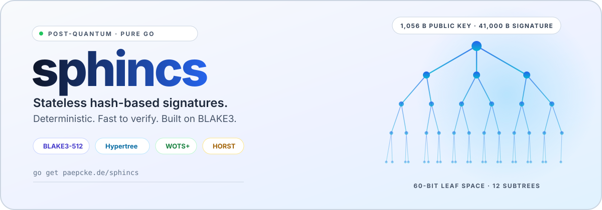
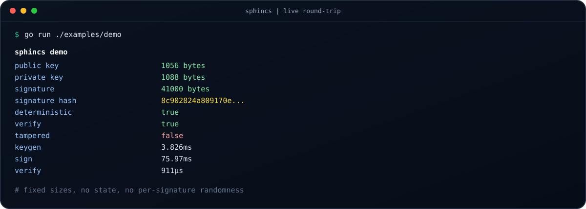
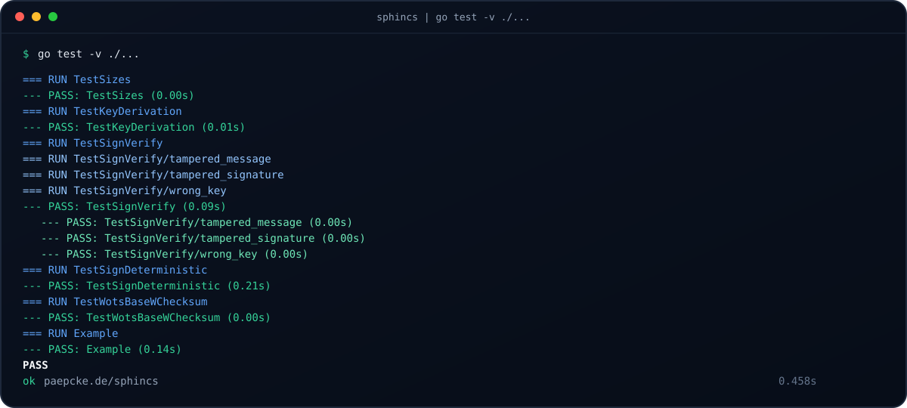
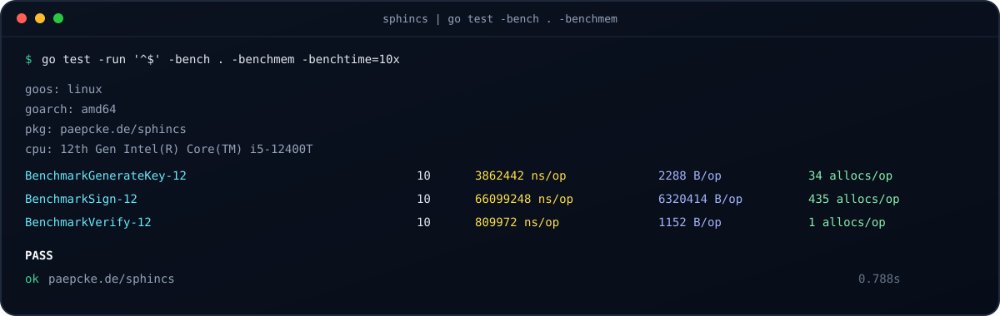

<div align="center">

<picture>
  <source media="(prefers-color-scheme: dark)" srcset="docs/hero-dark.svg">
  <source media="(prefers-color-scheme: light)" srcset="docs/hero-light.svg">
  
</picture>

# 🌲 sphincs

**Post-quantum signatures without the state.**

Stateless, hash-based, deterministic, and dependency-light. One tiny Go package
with a three-function API: `GenerateKey`, `Sign`, `Verify`.

[](https://pkg.go.dev/paepcke.de/sphincs)
[](https://goreportcard.com/report/paepcke.de/sphincs)
[](https://github.com/paepckehh/sphincs/actions/workflows/golang.yml)
[](https://github.com/paepckehh/sphincs/blob/main/LICENSE)
[](https://go.dev/dl/)

`go get paepcke.de/sphincs`

<picture>
  <source media="(prefers-color-scheme: dark)" srcset="docs/established-dark.svg">
  <source media="(prefers-color-scheme: light)" srcset="docs/established-light.svg">
  
</picture>

</div>

---

## 💡 Why

A signature scheme should not need a session, a counter, or a database. It
should not need a new dependency tree either. `sphincs` is a small, readable
implementation of a stateless hash-based hypertree signature scheme, built on
BLAKE3 and a compact ChaCha permutation.

- 🌲 **Stateless by design**: no per-signature state, no nonce tracking, no key
  reuse bookkeeping. Lose the process, keep the key.
- 🎯 **Deterministic signatures**: the same key and message always produce the
  same signature. Great for reproducible builds, tests, and audit trails.
- ⚡ **Fast verification**: sub-millisecond on modern hardware, which is where
  post-quantum signatures usually hurt.
- 🪶 **Tiny surface**: one package, three exported functions, one direct
  dependency (`github.com/zeebo/blake3`).
- 🧱 **Fixed-size ABI**: plain byte arrays for keys, messages, and signatures.
  No reflection, no serialization, no hidden allocation in the hash core.
- 🧪 **Tested**: round-trip, tamper detection, determinism, key derivation, and
  checksum encoding are covered by `go test ./...`.

> **Status: experimental.** This is a clean, maintained implementation for
> research, tooling, and interoperability experiments. It is not audited and
> it is not wire-compatible with SPHINCS+. Do not deploy it as the only
> signature scheme protecting production secrets without an independent review.

## 🏛️ NIST post-quantum status

Current as of **October 2026**. `sphincs` predates the NIST standard and is not
SLH-DSA, but the surrounding decisions define when and how hash-based signatures
are deployed. This section tracks the normative documents and what they mean for
this package.

### SPHINCS+ became SLH-DSA

NIST selected SPHINCS+ for standardization in 2022 and published **FIPS 205,
Stateless Hash-Based Digital Signature Standard**, on **13 August 2024**,
together with FIPS 203 (ML-KEM) and FIPS 204 (ML-DSA). FIPS 205 is the
normative definition of **SLH-DSA**: 12 parameter sets (SHA-2 and SHAKE, NIST
security categories 1, 3, and 5, small and fast variants), pure and pre-hash
modes, and a signing randomizer. NIST's guidance is that the three standards
can and should be used now.

SLH-DSA is a different construction from this repository. It uses a different
hypertree and leaf layout, SHA-2 or SHAKE instead of BLAKE3 and the ChaCha
permutation, and randomized signing. Keys and signatures produced here will not
verify against an SLH-DSA implementation, and vice versa.

### 2026: parameter sets for constrained signing

On **13 April 2026** NIST published the initial public draft of **SP 800-230,
Additional SLH-DSA Parameter Sets for Limited Signature Use Cases**. It adds six
parameter sets for security categories 1, 3, and 5 tuned for fast verification
and smaller signatures, by capping each key at **2^24 signatures**. They target
software, firmware, and certificate signing and are explicitly not approved for
general-purpose use. The comment period closed on 12 June 2026; the received
comments were posted on 1 July 2026.

### The additional-signature track

NIST's separate call for additional signature schemes, beyond the FIPS 204/205
baseline, is still running:

- **NIST IR 8528** (24 October 2024) advanced 14 of 40 first-round submissions
  to round 2.
- **NIST IR 8610** (14 May 2026) advanced nine candidates to round 3: FAEST,
  HAWK, MAYO, MQOM, QR-UOV, SDitH, SNOVA, SQIsign, and UOV. HAWK has since been
  withdrawn by its team. Round 3 is expected to last about two years, with the
  seventh NIST PQC standardization conference planned for 2027.
- FN-DSA (FIPS 206, derived from Falcon) has still not been published.

### Migration timeline

**NIST IR 8547, Transition to Post-Quantum Cryptography Standards** (initial
public draft, 12 November 2024) remains a draft, with no final version yet. It
plans to deprecate quantum-vulnerable algorithms after 2030 and disallow them
after 2035, with high-risk systems migrating earlier. On the key-establishment
side, **HQC** was selected for standardization on 11 March 2025 (NIST IR 8545),
alongside ML-KEM.

### Policy and implementation signals

- **NSA CNSA 2.0** (FAQ v2.1, December 2024) does **not** approve SLH-DSA for
  National Security Systems. For firmware and software signing it allows the
  stateful hash-based schemes LMS and XMSS from SP 800-208. General-purpose
  signatures use ML-DSA-87. CNSA 2.0 sets 2025 to 2035 milestones, with new NSS
  acquisitions required to be compliant from 1 January 2027.
- **BSI TR-02102-1** (version 2026-01, 23 January 2026) lists SLH-DSA among the
  recommended post-quantum signature schemes, next to ML-DSA and the stateful
  hash-based schemes.
- **OpenSSL 3.5.0** (8 April 2025) added SLH-DSA, ML-KEM, and ML-DSA, which puts
  the standard in mainstream TLS and CMS tooling. BoringSSL, Botan, and liboqs
  also ship SLH-DSA implementations.

### European guidance: BSI and ANSSI

**Germany (BSI).** BSI TR-02102-1 (version 2026-01, 23 January 2026) keeps
SLH-DSA among the recommended post-quantum signature schemes, next to ML-DSA and
the stateful XMSS/LMS family. BSI does not endorse the full FIPS 205 menu: the
128-bit sets are absent, leaving the 192- and 256-bit `s` and `f` variants at its
roughly 120-bit-plus baseline, and post-quantum schemes are recommended only in
hybrid combination with a classical scheme. The same revision sets Germany's
first fixed sunset dates, ending standalone classical key agreement after 2031
(2030 for the most sensitive uses) and classical-only signatures after 2035.

**France (ANSSI).** ANSSI's PQC position papers (2022 and 2023) and its current
PQC FAQ treat SLH-DSA as the conservative post-quantum signature option, fit for
use cases that tolerate large signatures and slower signing. Hash-based
signatures are the one explicit exception to ANSSI's otherwise mandatory
hybridisation rule: SLH-DSA, XMSS, and LMS "could be used today without
hybridation" because their security rests on the least-contested assumption,
whereas ML-DSA still needs a classical co-signature. Elsewhere hybridisation
remains the default, the regulated perimeter applies it strictly, and from 2027
ANSSI intends to stop qualifying products that lack post-quantum cryptography.

### Security research worth watching

- **SLasH-DSA** (arXiv:2509.13048, September 2025, revised February 2026)
  demonstrated the first software-only universal forgery against SLH-DSA, using
  Rowhammer-induced faults against OpenSSL 3.5.1 for several parameter sets.
  The scheme was not broken mathematically; the implementation was.
- Follow-up work on fault countermeasures (for example ePrint 2026/759, April
  2026) and on constant-time screening of PQC implementations (ePrint 2026/1418,
  July 2026) focuses on the same lesson: hash-based signatures need hardened
  implementations, not just sound parameters.

### What this means for sphincs

- **Not a drop-in standard.** If you need FIPS 205 conformance, interoperability,
  or a validated module, use a maintained SLH-DSA implementation. This package
  is a readable, self-contained hypertree implementation for research and
  tooling.
- **The design ideas still hold.** Stateless operation, deterministic
  derivation, fixed-size keys, and a hash-only security base remain the reasons
  hash-based signatures are the conservative post-quantum choice.
- **Deterministic signing is a deliberate difference.** FIPS 205 feeds a
  randomizer into signing; `sphincs` signs deterministically from the key and
  message.
- **No fault countermeasures.** The Rowhammer results are a reminder that
  signature code running on shared hardware needs fault and side-channel
  hardening that this library does not claim to provide.

### Primary documents

| Document | Title | Date | Status |
| :--- | :--- | :--- | :--- |
| [FIPS 205](https://csrc.nist.gov/pubs/fips/205/final) | Stateless Hash-Based Digital Signature Standard (SLH-DSA) | 13 Aug 2024 | Final |
| [FIPS 204](https://csrc.nist.gov/pubs/fips/204/final) | Module-Lattice-Based Digital Signature Standard (ML-DSA) | 13 Aug 2024 | Final |
| [FIPS 203](https://csrc.nist.gov/pubs/fips/203/final) | Module-Lattice-Based Key-Encapsulation Mechanism Standard (ML-KEM) | 13 Aug 2024 | Final |
| [SP 800-230](https://csrc.nist.gov/pubs/sp/800/230/ipd) | Additional SLH-DSA Parameter Sets for Limited Signature Use Cases | 13 Apr 2026 | Initial public draft |
| [NIST IR 8547](https://csrc.nist.gov/pubs/ir/8547/ipd) | Transition to Post-Quantum Cryptography Standards | 12 Nov 2024 | Initial public draft |
| [NIST IR 8528](https://csrc.nist.gov/pubs/ir/8528/final) | Status Report on the First Round of the Additional Digital Signature Schemes | 24 Oct 2024 | Final |
| [NIST IR 8610](https://csrc.nist.gov/pubs/ir/8610/final) | Status Report on the Second Round of the Additional Digital Signature Schemes | 14 May 2026 | Final |
| [NIST IR 8545](https://csrc.nist.gov/pubs/ir/8545/final) | Status Report on the Fourth Round of the NIST PQC Standardization Process (HQC) | 11 Mar 2025 | Final |
| [SP 800-208](https://csrc.nist.gov/pubs/sp/800/208/final) | Recommendation for Stateful Hash-Based Signature Schemes (LMS, XMSS) | Oct 2020 | Final |
| [SP 800-227](https://csrc.nist.gov/pubs/sp/800/227/final) | Recommendations for Key-Encapsulation Mechanisms | 18 Sep 2025 | Final |

## 🚀 Quick start

```go
package main

import (
	"crypto/rand"
	"fmt"

	"paepcke.de/sphincs"
)

func main() {
	var seed [sphincs.SeedTokenSize]byte
	if _, err := rand.Read(seed[:]); err != nil {
		panic(err)
	}

	pk, sk := sphincs.GenerateKey(seed)

	var msg [sphincs.MessageSize]byte
	copy(msg[:], "hello, post-quantum world")

	sig := sphincs.Sign(sk, msg)
	fmt.Println(sphincs.Verify(pk, msg, sig)) // true
}
```

Install it, or run the deterministic demo straight from the repo:

```shell
go get paepcke.de/sphincs@latest
go run ./examples/demo
```

## 📦 Sizes

| Item | Bytes |
| :--- | ---: |
| Public key | 1,056 |
| Private key / seed token | 1,088 |
| Signature | 41,000 |
| Message | 64 |
| Message digest | 64 |

The private key *is* the seed token. It contains the master seed, the public
masks, and the per-key signing random seed. Fill it with `crypto/rand`, store
it like a private key, and never derive it from a short password.

## 📊 Performance

Informal benchmark on an Intel i5-12400T, Go 1.27.2, linux/amd64:

| Operation | Time | Allocations |
| :--- | ---: | ---: |
| `GenerateKey` | ~3.9 ms | 34 |
| `Sign` | ~66 ms | 435 |
| `Verify` | ~0.81 ms | 1 |

```shell
go test -run '^$' -bench . -benchmem
```

Signing builds a fresh WOTS+ path for every level, so it does real work. It is
still comfortably in interactive range. Verification only walks the supplied
paths and usually lands well below one millisecond.

## 🎬 Showtime

Real output, captured from this repository. No mock-ups, no stock screenshots.

<p align="center">
  
</p>
<p align="center"><sub><b>One round-trip</b>: fixed sizes, deterministic signature, tampered message rejected.</sub></p>

<p align="center">
  
</p>
<p align="center"><sub><b>The whole suite, green</b>: round-trip, tamper detection, determinism, key derivation, checksum encoding.</sub></p>

<p align="center">
  
</p>
<p align="center"><sub><b>Real numbers</b>: key generation, signing, and sub-millisecond verification with allocation counts.</sub></p>

Run the demo or reproduce the benchmarks yourself:

```shell
go run ./examples/demo
go test -v ./...
go test -run '^$' -bench . -benchmem
```

## 🔬 How it works

`sphincs` is a 12-level hypertree over WOTS+ leaves, with a HORST few-time
signature at the bottom:

```text
message
   │
   ▼
BLAKE3-512 ──► leaf index + R
   │
   ▼
HORST signature over the message hash
   │
   ├── subtree 0: WOTS+ signature + auth path
   ├── subtree 1: WOTS+ signature + auth path
   │   ...
   └── subtree 11: WOTS+ signature + auth path
   │
   ▼
41,000-byte signature
```

- **Message digest**: BLAKE3-512, truncated to a 64-byte fixed message.
- **Tree**: 12 subtrees of height 5, giving a 60-bit leaf space.
- **Leaves**: WOTS+ with `w = 16`, `l = 67`.
- **Few-time layer**: HORST with `t = 2^16` and `k = 32`.
- **Seed expansion**: a 12-round ChaCha permutation with the same masked hash
  construction as the original SPHINCS-256 design.
- **Verification**: constant-time comparison of the reconstructed root against
  the public key.

The construction is derived from
[yawning/sphincs256](https://github.com/yawning/sphincs256) and keeps its
byte-level layout and parameter relationships. The hash and permutation choices
are intentional: BLAKE3-512 for message digests, BLAKE3-256 for seed derivation,
and a 12-round ChaCha permutation *without* the final feed-forward for the
masked tree hash.

## 🧭 API

```go
func GenerateKey(psrnd [SeedTokenSize]byte) (pk [PublicKeySize]byte, sk [PrivateKeySize]byte)
func Sign(sk [PrivateKeySize]byte, message [MessageSize]byte) (signature [SignatureSize]byte)
func Verify(pk [PublicKeySize]byte, message [MessageSize]byte, signature [SignatureSize]byte) bool
```

| Exported constant | Value | Meaning |
| :--- | ---: | :--- |
| `PublicKeySize` | 1,056 | Public key length |
| `PrivateKeySize` | 1,088 | Private key length |
| `SeedTokenSize` | 1,088 | Seed token accepted by `GenerateKey` |
| `SignatureSize` | 41,000 | Signature length |
| `HashSize` | 64 | BLAKE3-512 digest length |
| `MessageSize` | 64 | Fixed message length |

Everything is a fixed-size array. Keys and signatures are copied on every call,
which keeps the API safe to use from multiple goroutines and makes ownership
obvious.

## 🔐 Security notes

### ⚠️ Deterministic signing is intentional

Determinism is a design property of this API, not an accident and not a tunable.
`Sign` derives every one-time key, the leaf index, and `R` from the secret seed
and the message, so the same key and message always produce byte-identical
signatures. The library exposes no salt, nonce, or randomness parameter, and
that is deliberate.

If your use case requires randomized, hedged, or per-signature-unique
signatures, you **MUST** handle that upstream of this package, for example by
salting or domain-separating the 64-byte message with a fresh random value and
including that value in the signed envelope. This is not the right place to add
randomness: do not modify `Sign`, do not fork the derivation, and do not wrap
the primitive in a way that changes what is actually signed.

If you do not already understand the implications of deterministic signatures
(repeatable signatures, cross-context linkability, fault attacks that can expose
key material, and the need for caller-side uniqueness wherever the protocol
demands it), **do not use this cryptographic primitive**.

- **Experimental, not audited.** Treat this as a serious implementation, not a
  certified one.
- **Deterministic signing.** See the warning above: no per-signature randomness,
  and any salt or nonce belongs upstream of `Sign`.
- **Fixed message size.** `Sign` and `Verify` accept exactly 64 bytes. Hash or
  frame longer messages before signing.
- **Fixed-size keys.** The seed token must be generated with a CSPRNG and kept
  secret. It is not stretched from a passphrase.
- **Best-effort wiping.** Local private material is cleared before return, but
  Go gives no hard guarantee against copies made by the runtime or the OS.
- **Root comparison is constant-time.** Verification uses
  `crypto/subtle.ConstantTimeCompare` for the final root check.

Report vulnerabilities to `alert.git (/AT/) paepcke.de`. See
[SECURITY.md](SECURITY.md).

## 🧩 Design decisions

- **Stateless beats stateful.** No leaf counter means no multi-process locking
  and no "signing state" to back up.
- **Hash-based beats number-theoretic.** Security rests on hash and permutation
  assumptions, not on factoring or discrete logarithms.
- **BLAKE3 is fast and boring.** The message path uses a well-tested BLAKE3
  implementation instead of a hand-rolled compression function.
- **Tiny API beats a framework.** Three functions and six constants are enough
  to sign, verify, and reason about key sizes.
- **One dependency beats ten.** `zeebo/blake3` is the only direct dependency.

## 🧪 Development

```shell
make check          # gofmt, go vet, go test
make build          # go build -v ./...
make test           # go test ./...
make vet            # go vet ./...
make fmt            # gofmt -w -s .
make lint           # staticcheck ./... (optional)
```

The library itself has no subpackages, no generated code, and no build tags
beyond the two architecture-specific permutation implementations. The runnable
round-trip demo lives in `examples/demo`.

## 📚 Docs and references

- API reference: [pkg.go.dev/paepcke.de/sphincs](https://pkg.go.dev/paepcke.de/sphincs)
- Project home: [paepcke.de/sphincs](https://paepcke.de/sphincs/)
- Hero artwork: [dark](docs/hero-dark.svg) / [light](docs/hero-light.svg)
- Established banner: [dark](docs/established-dark.svg) / [light](docs/established-light.svg)
- Screenshots: [round-trip](docs/screenshot-demo.svg) / [tests](docs/screenshot-tests.svg) / [benchmarks](docs/screenshot-bench.svg)
- Original implementation: [github.com/yawning/sphincs256](https://github.com/yawning/sphincs256) (BSD-3-Clause)
- BLAKE3: [github.com/zeebo/blake3](https://github.com/zeebo/blake3) (CC0)
- SPHINCS+ paper: [cryptojedi.org/papers/spx-20190923.pdf](https://cryptojedi.org/papers/spx-20190923.pdf)
- SPHINCS+ reference code: [github.com/sphincs/sphincsplus](https://github.com/sphincs/sphincsplus)
- NIST FIPS 205 (SLH-DSA): [csrc.nist.gov/pubs/fips/205/final](https://csrc.nist.gov/pubs/fips/205/final)
- NIST PQC project: [csrc.nist.gov/projects/post-quantum-cryptography](https://csrc.nist.gov/projects/post-quantum-cryptography)
- NIST additional digital signatures: [csrc.nist.gov/projects/pqc-dig-sig](https://csrc.nist.gov/projects/pqc-dig-sig)

## 👯 Sibling projects

Same author, same "small tool, sharp edges" philosophy:

- [certinfo](https://github.com/paepckehh/certinfo): decode x.509, CSRs, and SSH keys
- [tlsinfo](https://github.com/paepckehh/tlsinfo): inspect TLS endpoints and certificates

## 🤝 Contributing

Yes, please. PRs, issue reports, benchmarks, and independent review are all
welcome. See [CONTRIBUTING.md](CONTRIBUTING.md).

## 🛡 License

BSD 3-Clause. See [LICENSE](LICENSE).

## 📃 Citation

```bibtex
@misc{sphincs,
  author = {Michael Paepcke},
  title = {sphincs: stateless hash-based post-quantum signatures in pure Go},
  year = {2022},
  publisher = {GitHub},
  journal = {GitHub repository},
  howpublished = {\url{https://paepcke.de/sphincs}}
}
```

Special thanks to Daniel J. Bernstein, Andreas Huelsing, Stefan Koelbl, Ruben
Niederhagen, Joost Rijneveld, and Peter Schwabe for the SPHINCS framework, and
to the authors of `yawning/sphincs256` and `zeebo/blake3`.
